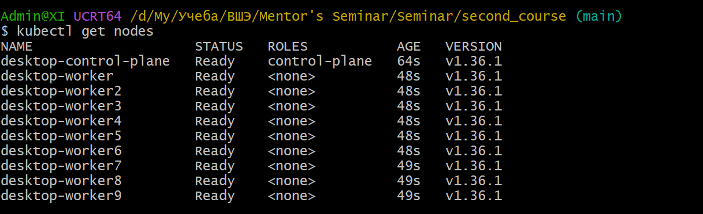
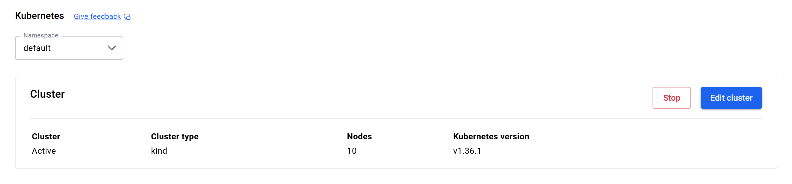
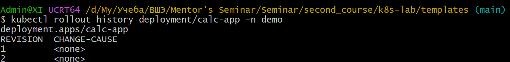
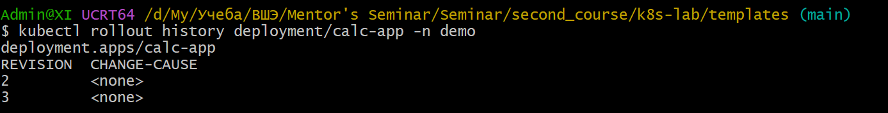
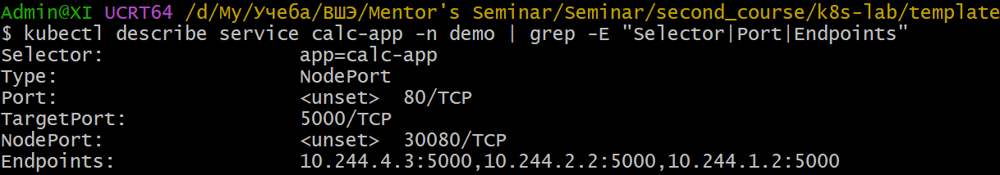
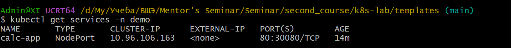
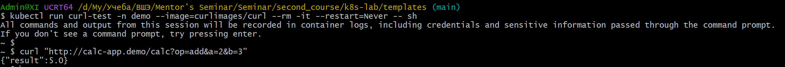
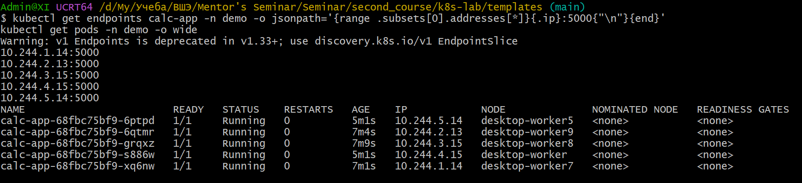
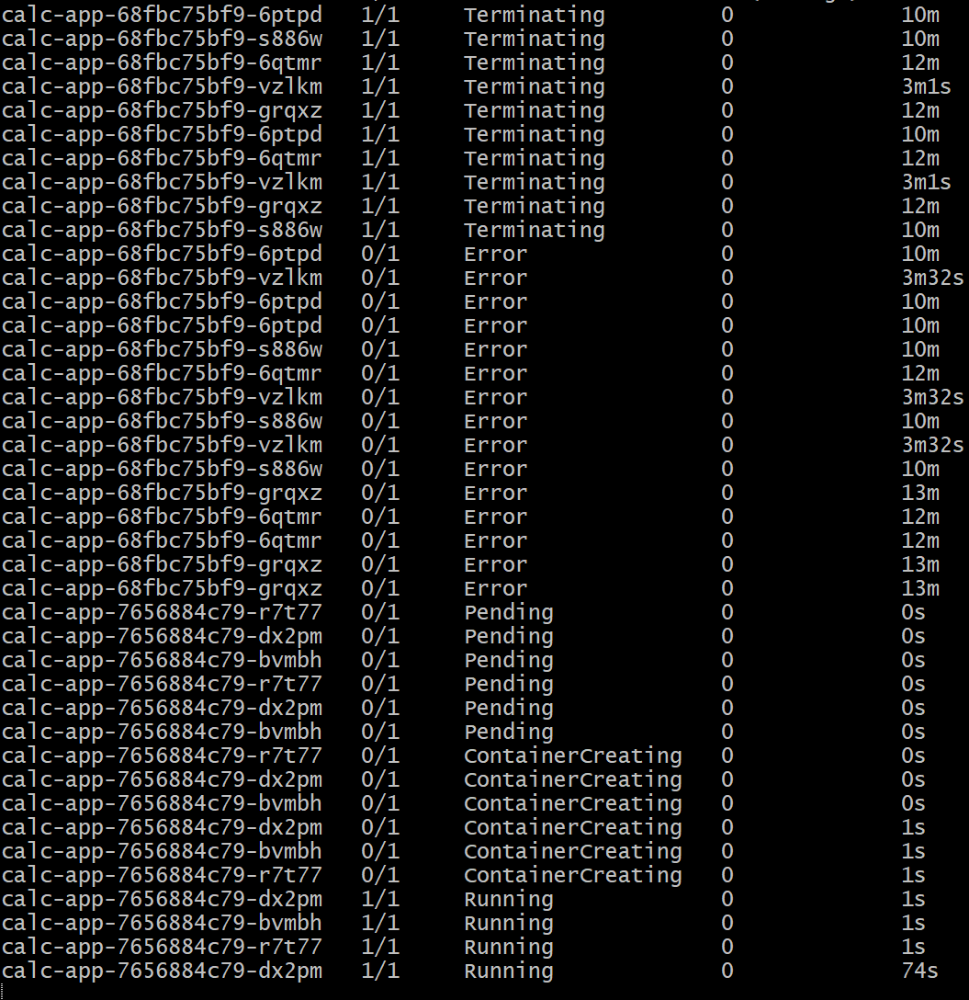
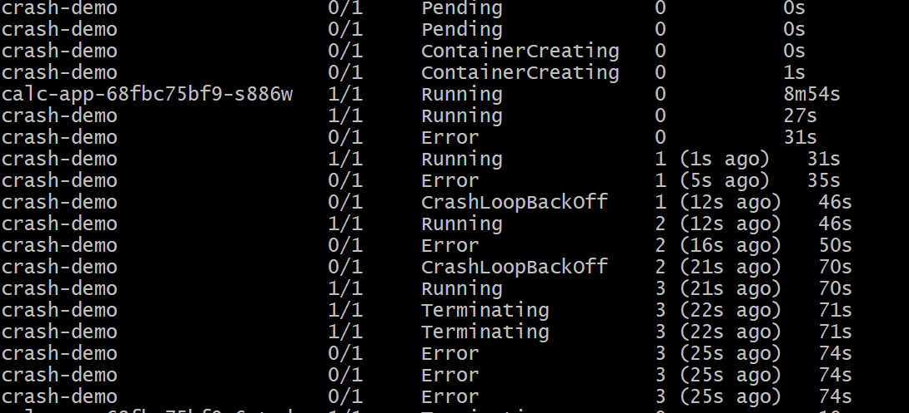

# Отчёт по лабораторной работе № 1
## «Развёртывание приложения в Kubernetes»

**Студент:** Ильин Марат Викторович
**Группа:** МИНДА251
**Дата:** 24.11.2026

---

## Задание 1. Кластер

Kubelet Version (Kubernetes): v1.36.1
Container Runtime Version: containerd://2.3.1
CPU: 16
Memory: ~7.9 ГБ
MemoryPressure - False
DiskPressure - False
PIDPressure - False
Ready - True

- Вывод `kubectl get nodes` (скриншот или текст):



$ kubectl get nodes
NAME                    STATUS   ROLES           AGE   VERSION
desktop-control-plane   Ready    control-plane   23m   v1.36.1
desktop-worker          Ready    <none>          23m   v1.36.1
desktop-worker2         Ready    <none>          23m   v1.36.1
desktop-worker3         Ready    <none>          23m   v1.36.1
desktop-worker4         Ready    <none>          23m   v1.36.1
desktop-worker5         Ready    <none>          23m   v1.36.1
desktop-worker6         Ready    <none>          23m   v1.36.1
desktop-worker7         Ready    <none>          23m   v1.36.1
desktop-worker8         Ready    <none>          23m   v1.36.1
desktop-worker9         Ready    <none>          23m   v1.36.1

- Сколько нод в кластере и почему?
Одна control-plane нода, desktop-control-plane — управляет кластером (API-сервер, etcd, scheduler, controller-manager).
Девять worker-нод, desktop-worker и desktop-worker2 … desktop-worker9 — на них запускаются пользовательские приложения.
Я поднимал кластер через desktop версию докера, сам установил 10 нод.


## Задание 2. Pod

- Команда, которой вы запустили под: kubectl run calc-pod --image=localhost:5000/calc-app:v1 --port=5000 (дал комментарии в pod.yaml)
- Ответ приложения на `/calc?op=mul&a=6&b=7`: {"result": 42.0}
- Что произошло после `kubectl delete pod`? Почему?
$ kubectl delete pod calc-pod
pod "calc-pod" deleted from default namespace
Под был удалён и не восстановился.Это автономный под, который никто не контролирует, т.к. у него нет ни Deployment, ни ReplicaSet, ни StatefulSet, которые могли бы его пересоздать и следить за его состоянием. 

## Задание 3. Deployment

- Вывод `kubectl get deployments,replicasets,pods -n demo`:
Admin@XI UCRT64 /d/My/Учеба/ВШЭ/Mentor's Seminar/Seminar/second_course/k8s-lab/templates (main)
$ kubectl get deployments,replicasets,pods -n demo
NAME                       READY   UP-TO-DATE   AVAILABLE   AGE
deployment.apps/calc-app   3/3     3            3           21m

NAME                                  DESIRED   CURRENT   READY   AGE
replicaset.apps/calc-app-58964f5766   0         0         0       19m
replicaset.apps/calc-app-7656884c79   3         3         3       21m

NAME                            READY   STATUS    RESTARTS   AGE
pod/calc-app-7656884c79-9sqwh   1/1     Running   0          3m33s
pod/calc-app-7656884c79-hm49g   1/1     Running   0          3m29s
pod/calc-app-7656884c79-pdq64   1/1     Running   0          3m34s

- Объясните имена подов: из каких частей они состоят?
**Имя пода** `calc-app-7656884c79-9sqwh`:
- `calc-app` — имя Deployment;
- `7656884c79` — хеш шаблона пода, он же суффикс имени ReplicaSet;
- `9sqwh` — случайный суффикс, делающий имя пода уникальным.
- Что показал `kubectl rollout history`?

Команда показывает список ревизий Deployment `calc-app`. Каждая ревизия
соответствует версии шаблона пода (в нашем случае образу контейнера),
и за ней стоит свой ReplicaSet.

До отката (после обновления на v2) в истории две ревизии:
- ревизия 1 — версия v1 (ReplicaSet `7656884c79`);
- ревизия 2 — версия v2 (ReplicaSet `58964f5766`).

$ kubectl rollout history deployment/calc-app -n demo
deployment.apps/calc-app
REVISION  CHANGE-CAUSE
1         <none>
2         <none>


После отката (`kubectl rollout undo`) в истории ревизии 2 и 3:
- ревизия 2 — версия v2 (ReplicaSet `58964f5766`);
- ревизия 3 — версия v1 (ReplicaSet `7656884c79`).

$ kubectl rollout history deployment/calc-app -n demo
deployment.apps/calc-app
REVISION  CHANGE-CAUSE
2         <none>
3         <none>


Отвечая на вопрос, Deployment сам поды не создаёт. Он управляет ReplicaSet'ами, а ReplicaSet отвечает за поды: следит, чтобы работало ровно заданное число копий, и пересоздаёт под, если тот упал или был удалён.

## Задание 4. Service

- Содержимое секции Endpoints вашего сервиса: 10.244.1.2:8080,10.244.4.3:8080,10.244.2.2:8080

- Чем вы объясняете, что DNS-имя `calc-app.demo` работает изнутри кластера?
В кластере работает DNS-сервер CoreDNS, и каждый под настроен использовать его. Для каждого Service CoreDNS создаёт запись `<сервис>.<namespace>.svc.cluster.local`, указывающую на ClusterIP сервиса (у меня `10.96.106.163`). Короткое имя `calc-app.demo` работает благодаря search-доменам в `/etc/resolv.conf` пода: к нему автоматически дописывается `svc.cluster.local`. Запрос на ClusterIP kube-proxy перенаправляет на один из подов из Endpoints, поэтому имя остаётся рабочим, даже когда адреса подов меняются.

1. Вывод `kubectl get services -n demo` и строку Endpoints из describe
$ kubectl get services -n demo
NAME       TYPE       CLUSTER-IP      EXTERNAL-IP   PORT(S)        AGE
calc-app   NodePort   10.96.106.163   <none>        80:30080/TCP   14m

2. Ответ `curl` по DNS-имени из тестового пода
Admin@XI UCRT64 /d/My/Учеба/ВШЭ/Mentor's Seminar/Seminar/second_course/k8s-lab/templates (main)
$ kubectl run curl-test -n demo --image=curlimages/curl --rm -it --restart=Never -- sh
All commands and output from this session will be recorded in container logs, including credentials and sensitive information passed through the command prompt.
If you don't see a command prompt, try pressing enter.
~ $
~ $ curl "http://calc-app.demo/calc?op=add&a=2&b=3"
{"result":5.0}


3. Ответ: как Service узнаёт, какие поды живы? (подсказка: selector, Endpoints)
Service сам за подами не следит. У него есть `selector: app=calc-app`. Контроллер Endpoints в control plane постоянно ищет поды в namespace с такой меткой и записывает адреса тех, кто готов принимать
трафик (статус Ready), в Endpoints. Если под упал, удалён или не прошёл проверку готовности, его адрес из списка убирается. Новый под с той же меткой автоматически добавляется. 

## Задание 5. Scaling

- Что показал `kubectl describe service` после scale до 5 реплик?

В секции Endpoints стало 5 адресов (`10.244.x.x:5000`) вместо трёх: по одному на каждый под.
Service сам ничего не менял, selector остался прежним. Новые поды получили метку `app=calc-app` и после прохождения проверки готовности автоматически попали в Endpoints.

Admin@XI UCRT64 /d/My/Учеба/ВШЭ/Mentor's Seminar/Seminar/second_course/k8s-lab/templates (main)
$ kubectl get pods -n demo
NAME                        READY   STATUS    RESTARTS   AGE
calc-app-68fbc75bf9-6qtmr   1/1     Running   0          71s
calc-app-68fbc75bf9-grqxz   1/1     Running   0          76s
calc-app-68fbc75bf9-xq6nw   1/1     Running   0          68s

Admin@XI UCRT64 /d/My/Учеба/ВШЭ/Mentor's Seminar/Seminar/second_course/k8s-lab/templates (main)
$ kubectl scale deployment calc-app --replicas=5 -n demo
deployment.apps/calc-app scaled

Admin@XI UCRT64 /d/My/Учеба/ВШЭ/Mentor's Seminar/Seminar/second_course/k8s-lab/templates (main)
$ kubectl get pods -n demo
NAME                        READY   STATUS    RESTARTS   AGE
calc-app-68fbc75bf9-6ptpd   1/1     Running   0          8s
calc-app-68fbc75bf9-6qtmr   1/1     Running   0          2m11s
calc-app-68fbc75bf9-grqxz   1/1     Running   0          2m16s
calc-app-68fbc75bf9-s886w   1/1     Running   0          8s
calc-app-68fbc75bf9-xq6nw   1/1     Running   0          2m8s

Admin@XI UCRT64 /d/My/Учеба/ВШЭ/Mentor's Seminar/Seminar/second_course/k8s-lab/templates (main)
$ kubectl get endpoints calc-app -n demo
Warning: v1 Endpoints is deprecated in v1.33+; use discovery.k8s.io/v1 EndpointSlice
NAME       ENDPOINTS                                                        AGE
calc-app   10.244.1.14:5000,10.244.2.13:5000,10.244.3.15:5000 + 2 more...   34m

Admin@XI UCRT64 /d/My/Учеба/ВШЭ/Mentor's Seminar/Seminar/second_course/k8s-lab/templates (main)
$ kubectl describe service calc-app -n demo | grep -E "Selector|TargetPort|Endpoints"
Selector:                 app=calc-app
TargetPort:               5000/TCP
Endpoints:                10.244.3.15:5000,10.244.2.13:5000,10.244.1.14:5000 + 2 more...


- В чём разница между `kubectl scale` и правкой YAML + apply?
  Какой способ выбрали бы для production?


1. Вывод Endpoints при 5 репликах

Необрезанный вывод.

Admin@XI UCRT64 /d/My/Учеба/ВШЭ/Mentor's Seminar/Seminar/second_course/k8s-lab/templates (main)
$ kubectl get endpoints calc-app -n demo -o jsonpath='{range .subsets[0].addresses[*]}{.ip}:5000{"\n"}{end}'
kubectl get pods -n demo -o wide
Warning: v1 Endpoints is deprecated in v1.33+; use discovery.k8s.io/v1 EndpointSlice
10.244.1.14:5000
10.244.2.13:5000
10.244.3.15:5000
10.244.4.15:5000
10.244.5.14:5000
NAME                        READY   STATUS    RESTARTS   AGE    IP            NODE              NOMINATED NODE   READINESS GATES
calc-app-68fbc75bf9-6ptpd   1/1     Running   0          5m1s   10.244.5.14   desktop-worker5   <none>           <none>
calc-app-68fbc75bf9-6qtmr   1/1     Running   0          7m4s   10.244.2.13   desktop-worker9   <none>           <none>
calc-app-68fbc75bf9-grqxz   1/1     Running   0          7m9s   10.244.3.15   desktop-worker8   <none>           <none>
calc-app-68fbc75bf9-s886w   1/1     Running   0          5m1s   10.244.4.15   desktop-worker    <none>           <none>
calc-app-68fbc75bf9-xq6nw   1/1     Running   0          7m1s   10.244.1.14   desktop-worker7   <none>           <none>



2. Ответ: чем императивный `kubectl scale` отличается от декларативного `apply`? Какой способ правильный для production и почему?
`kubectl scale` - императивный способ. Через команду говорим кластеру, что сделать, и меняем только живой объект. В `deployment.yaml` по-прежнему написано старое число реплик (3), поэтому файл и кластер расходятся, а следующий `kubectl apply` вернёт реплики к значению из файла, снова будет 3 как у нас в файле.

3. (по эксперименту) что происходит с подами, которым не хватило ресурсов?
Планировщик не находит узел с достаточным свободным CPU/памятью (по `requests`), поэтому под остаётся в статусе `Pending`, а в Events появляется `FailedScheduling ... Insufficient cpu`. 
Под не запускается и не получает трафик, в Endpoints он не попадает. Уже работающие поды это не затрагивает. 
Под останется в `Pending`, пока не освободятся ресурсы, после чего планировщик сам его разместит.
В нашем запуске при `requests.cpu=500m`и 50 репликах все поды запустились, потому что ресурсов у Docker Desktop хватило.

## Задание 6. Self-healing

- Опишите, что вы наблюдали после удаления пода (со скриншотом `-w`): Я удалил под `calc-app-68fbc75bf9-xq6nw`. Он перешёл в `Terminating`, и сразу же появился новый под `calc-app-68fbc75bf9-vzlkm`: 
`Pending` → `ContainerCreating` → `Running`. Число подов вернулось к 5. ReplicaSet заметил, что реплик стало меньше желаемого числа (5), и создал недостающий под.
- Что изменилось в колонке RESTARTS у crash-demo? Что такое CrashLoopBackOff?
Контейнер `crash-demo` завершается с кодом 1 через 3 секунды после старта, поэтому счётчик RESTARTS рос: 0 → 1 → 2 → 3. 
Статус чередуется `Running` → `Error` → `CrashLoopBackOff` → `Running`.
`CrashLoopBackOff` означает, что контейнер раз за разом падает, а kubelet перезапускает его с растущей задержкой (10 с, 20 с, 40 с и т.д.), чтобы не перегружать узел.
- Кто восстанавливает под, а кто — контейнер? (ответ одной фразой)
Упавший контейнер перезапускает kubelet на узле, а удалённый под пересоздаёт ReplicaSet.

1. Скриншот терминала с `-w` в момент пересоздания пода

2. Вывод `kubectl get pods` с растущим RESTARTS у crash-demo

3. Ответы: кто восстанавливает под, а кто — контейнер?
   Упавший контейнер перезапускает kubelet на узле, а удалённый под пересоздаёт ReplicaSet.
   Почему после удаления deployment ничего не восстановилось?
   Deployment создаёт ReplicaSet, а ReplicaSet создаёт поды. Восстанавливает поды именно ReplicaSet, а Deployment следит за самим ReplicaSet.


## Вывод

2–3 предложения: что такое desired state и почему Kubernetes называют
декларативной системой.


Desired state (желаемое состояние) - это описание того, что должно работать в кластере, например «5 копий `calc-app` версии v1 или v2». Они хранятся в объектах вроде Deployment. 
Kubernetes называют декларативной системой, потому что мы описываем что хотим получить (манифест), а не как это сделать, а контроллеры постоянно сравнивают фактическое состояние с желаемым и сами устраняют расхождения,  пересоздают упавшие и удалённые поды, докручивают число реплик. Поэтому под, который мы удалили, вернулся сам, а после удаления Deployment восстанавливать стало нечего, потому что желаемое состояние исчезло вместе с объектом.

---

**Самооценка по чек-листу** (`tasks/07-review.md`): 12 из 12 команд
выполнены без подглядывания.


1. Pod - минимальная единица запуска в Kubernetes, обёртка над одним или несколькими контейнерами с общей сетью и томами. Контейнер - это отдельный процесс из образа.
2. Deployment сам поды не создаёт. ReplicaSet держит нужное число копий одной версии, а Deployment управляет ReplicaSet.
3. IP пода временный, при пересоздании он меняется. Service даёт постоянный адрес и DNS-имя и балансирует по живым подам.
4. Desired state - описанное в манифесте желаемое состояние кластера. Его поддерживают контроллеры (Deployment, ReplicaSet), сравнивая желаемое с фактическим.
5. Изолирует имена и объекты (поды, сервисы, Deployment, квоты, RBAC). Не изолирует: сеть (поды из разных namespace видят друг друга), узлы, nodePort и сами кластерные ресурсы (Node, PV).
6. `kubectl get pods -n <ns>`, `kubectl describe pod <под> -n <ns>` (Events), `kubectl logs <под> -n <ns>` (при рестартах с `--previous`).


1. Добавьте в deployment контейнеру:
   ```yaml
   resources:
     requests: {cpu: 100m, memory: 64Mi}
     limits:   {cpu: 200m, memory: 128Mi}
   ```
   Что меняется при scheduling? (подсказка: `kubectl describe node`)


Планировщик размещает под по `requests`. ОН ищет узел, где свободно не меньше 100m CPU и 64Mi памяти с учётом уже размещённых подов. 
В `kubectl describe node desktop-worker` в блоке Allocated resources сумма Requests включает requests размещённых на узле подов `calc-app` (по 100m CPU и 64Mi памяти на каждый) и системные поды.
Если сумма requests превышает ёмкость всех узлов, новые поды остаются в `Pending`.
`limits` на размещение не влияют, т.к. это потолок ресурсов во время работы, в таком случае CPU замедляется, а при превышении памяти контейнер убивается с `OOMKilled`.

```
$ kubectl describe node desktop-worker | grep -A8 "Allocated resources"
Allocated resources:
  (Total limits may be over 100 percent, i.e., overcommitted.)
  Resource           Requests    Limits
  --------           --------    ------
  cpu                200m (1%)   300m (1%)
  memory             114Mi (1%)  178Mi (2%)
  ephemeral-storage  0 (0%)      0 (0%)
  hugepages-1Gi      0 (0%)      0 (0%)
  hugepages-2Mi      0 (0%)      0 (0%)
```


2. Добавьте `livenessProbe` (httpGet на `/health`, порт 5000) и объясните, что она даёт сверх restartPolicy.

`restartPolicy` реагирует только на завершение процесса. Если контейнер жив, но завис и не отвечает, kubelet этого не заметит. 
`livenessProbe` каждые 10 секунд делает HTTP-запрос к `/health`, и после трёх неудач подряд kubelet перезапускает контейнер. Грубо говоря, это проверка на зависание и т.п.

Admin@XI UCRT64 /d/My/Учеба/ВШЭ/Mentor's Seminar/Seminar/second_course/k8s-lab/templates (main)
$ kubectl describe pod -n demo -l app=calc-app | grep -i liveness
    Liveness:     http-get http://:5000/health delay=5s timeout=1s period=10s #success=1 #failure=3
    Liveness:     http-get http://:5000/health delay=5s timeout=1s period=10s #success=1 #failure=3
    Liveness:     http-get http://:5000/health delay=5s timeout=1s period=10s #success=1 #failure=3


3. Переведите приложение в namespace `production`. Что придётся поменять в манифестах и командах?

- Создать namespace: `kubectl create namespace production`.
- В манифестах Deployment и Service заменить `metadata.namespace: demo` на `production`.
- Во всех командах заменить `-n demo` на `-n production`.
- DNS-имя сервиса меняется на `calc-app.production`.
- `nodePort` должен быть уникален на весь кластер, поэтому при работе обоих namespace одновременно у сервиса в `production` 30081 вместо 30080.
- Объекты в разных namespace изолированы: Service выбирает только поды своего namespace.

Admin@XI UCRT64 /d/My/Учеба/ВШЭ/Mentor's Seminar/Seminar/second_course/k8s-lab/templates (main)
$ kubectl get deployments,services -A | grep calc-app
demo                 deployment.apps/calc-app                 3/3     3            3           5m39s
production           deployment.apps/calc-app                 3/3     3            3           31s
demo          service/calc-app     NodePort    10.96.228.21    <none>        80:30080/TCP             5m27s
production    service/calc-app     NodePort    10.96.178.163   <none>        80:30081/TCP             31s
